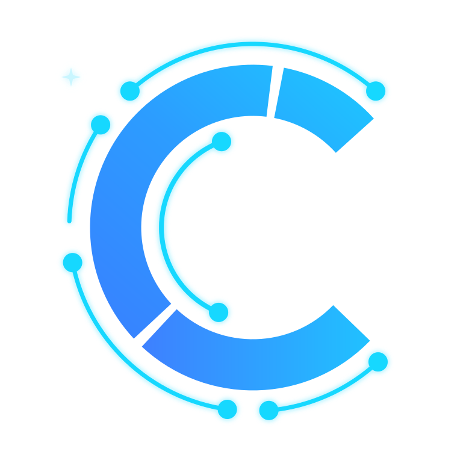
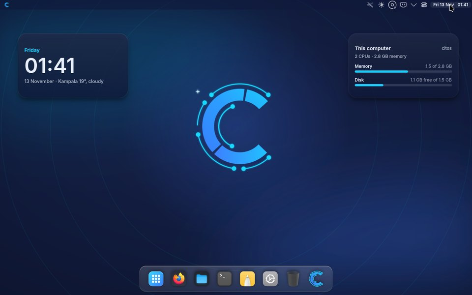
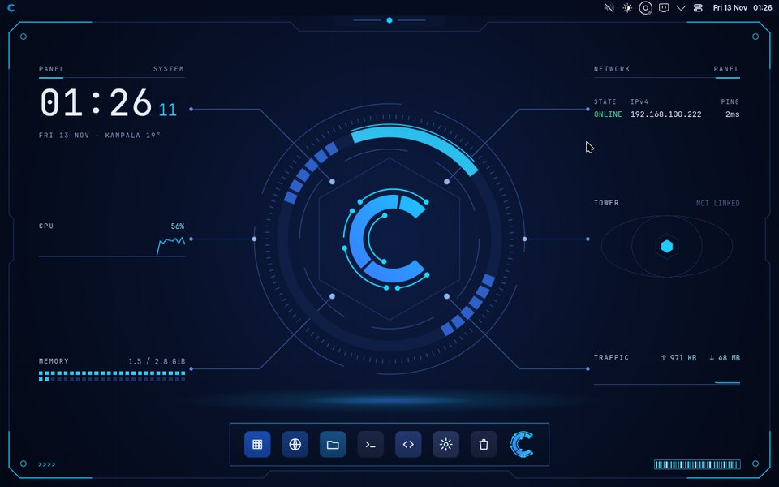

<div align="center">



# CybroidOS

**A secure, self-updating desktop operating system for engineers, security teams, schools and offices.**

[](https://github.com/cybroidos/os/actions/workflows/ci.yml)
[](LICENSE)
[](https://www.debian.org/releases/trixie/)
[](https://kde.org/plasma-desktop/)

[Download](https://cybroid.com/cybroidos) · [Install guide](docs/user/INSTALL.md) · [What's new](CHANGELOG.md) · [Contributing](CONTRIBUTING.md) · [Security](docs/SECURITY.md)

</div>

---

<p align="center">
  
  
</p>
<p align="center"><sub>Horizon (left) and Hex (right), the two interfaces of CybroidOS.</sub></p>

## Overview

CybroidOS is a desktop operating system built on Debian 13 and KDE Plasma 6 by
[Cybroid](https://cybroid.com). It is secure from the first boot, keeps itself
up to date, and runs well on the computers organisations already own. One
download serves everyone: at first sign-in, each person chooses the editions
(sets of professional tools) the computer needs.

## Features

| | |
|---|---|
| **Two interfaces** | *Horizon*, a calm and familiar desktop, and *Hex*, which keeps system and network status in view. Both in light and dark, switchable at any time. |
| **Automatic, signed updates** | Security fixes and CybroidOS updates install in the background from `deb.cybroid.com`, signed with the CybroidOS archive key. |
| **Secure by default** | A firewall from the first boot, AppArmor, optional full-disk encryption, no advertising and no tracking. |
| **Office-ready** | ONLYOFFICE as the default office suite for Word, Excel and PowerPoint files; Firefox; printers and network scanners found automatically. |
| **Industry-standard tools** | Editions bring the tools each profession uses: Visual Studio Code, Docker, Wireshark, KiCad, Kali's toolset and more. |
| **Built for organisations** | A private network (Tower) and enrolment into [Hangar](https://cybroid.com/hangar), Cybroid's console for managing every computer. |

## Editions

Editions are packages, not separate downloads. The welcome screen offers them
at first sign-in, and **Settings › About › Add an edition** adds more later.
Several can be installed together.

| Edition | For | Highlights |
|---|---|---|
| **Developer** | Software engineers | Visual Studio Code, Docker Engine with Compose, Git and GitHub CLI, Python, Java, Node.js, Go, Rust, PHP, Postman, DBeaver |
| **Security** | Analysts and security teams | Kali Linux's toolset (Burp Suite, Metasploit) in a container, Nmap, Wireshark, Hydra, hashcat, forensics tools |
| **Network** | Network engineers and students | Wireshark, PuTTY, WinBox, iperf3, TFTP and DHCP for lab devices, FRRouting, Ansible, Netmiko |
| **Engineering** | Electronics, CAD and science | KiCad, FreeCAD, LibreCAD, Arduino IDE 2, circuit and logic simulators, GNU Octave, JupyterLab |
| **Classroom** | School computer rooms | Veyon classroom management, lab accounts reset at each start, Scratch, GeoGebra, Kiwix (Wikipedia offline) |

## Getting started

1. **Download** the ISO from [cybroid.com/cybroidos](https://cybroid.com/cybroidos)
   and verify it: `sha256sum -c cybroidos-desktop-*.iso.sha256`.
2. **Write** it to a USB stick of 8 GB or more with balenaEtcher, Rufus (DD mode) or `dd`.
3. **Start** the computer from the stick, try CybroidOS live, and choose **Install CybroidOS** when ready.

The full guide, including installing alongside Windows, is in
[docs/user/INSTALL.md](docs/user/INSTALL.md).

### System requirements

| | Minimum | Recommended |
|---|---|---|
| Processor | 64-bit Intel or AMD | 64-bit Intel or AMD |
| Memory | 2 GB | 4 GB |
| Disk | 15 GB | 15 GB, plus room for editions |
| Installation media | USB stick, 8 GB | USB stick, 8 GB |

## Documentation

| Topic | Document |
|---|---|
| Installing | [docs/user/INSTALL.md](docs/user/INSTALL.md) |
| First boot | [docs/user/FIRST-BOOT.md](docs/user/FIRST-BOOT.md) |
| Updates | [docs/user/UPDATES.md](docs/user/UPDATES.md) |
| Recovery | [docs/user/RECOVERY.md](docs/user/RECOVERY.md) |
| Support | [docs/user/SUPPORT.md](docs/user/SUPPORT.md) |
| Architecture decisions | [docs/adr/](docs/adr/) |
| Release process | [docs/RELEASE-CHECKLIST.md](docs/RELEASE-CHECKLIST.md) |

## Building from source

CybroidOS builds on Debian 13 (or in the provided dev container). The ISO
build needs Docker and root.

```sh
tools/build-package.sh --all     # CybroidOS packages, into dist/
tools/build-extras.sh iso        # native apps and third-party components, into dist/extra
sudo EXTRA_DEBS="$PWD/dist/extra" OUT="$PWD/out" targets/desktop/build-iso.sh
```

The ISO is written to `out/`. To build an ISO with an edition preinstalled
(for computers without internet), set `EDITION=developer` (or `security`,
`network`, `engineering`, `classroom`). Release ISOs are built by
[GitHub Actions](.github/workflows/release-images.yml) from a version tag.

### Repository layout

```
apps/desktop/       CybroidOS's own apps: Settings, the welcome, Camera, and the Cybroid.Ui module
common/branding/    the brand: name, palette, mark and wallpapers (brand.toml)
common/packages/    the cybroid-* Debian packages, editions included
targets/desktop/    the installer ISO (live-build and Calamares)
targets/server/     server and desktop VM images
targets/container/  container images (Proxmox LXC, Docker)
tools/              build, branding and publishing scripts
docs/               user guides, architecture decisions and plans
```

## Contributing

Contributions are welcome. Read [CONTRIBUTING.md](CONTRIBUTING.md) first:
pull requests need a `Signed-off-by` line ([DCO](https://developercertificate.org/)),
must pass CI, and should explain how the change was tested. Everyone taking
part is expected to follow the [Code of Conduct](CODE_OF_CONDUCT.md).

## Security

Please report vulnerabilities privately, as described in
[docs/SECURITY.md](docs/SECURITY.md), and not in a public issue.

## Licence

CybroidOS's code, packaging and configuration are free software under the
[GNU General Public License v3.0 or later](LICENSE). The CybroidOS name, mark
and artwork are licensed under [CC BY-NC 4.0](LICENSE-ASSETS) and are
trademarks of Cybroid Technologies (U) Ltd; systems built from this source
under another name must not use them. See [NOTICE.md](NOTICE.md) and
[docs/LICENSING.md](docs/LICENSING.md). The few non-free components an image
contains, mainly device firmware, are listed in
[docs/PROPRIETARY-COMPONENTS.md](docs/PROPRIETARY-COMPONENTS.md).

---

<p align="center"><sub>© Cybroid Technologies (U) Ltd · <a href="https://cybroid.com">cybroid.com</a></sub></p>
